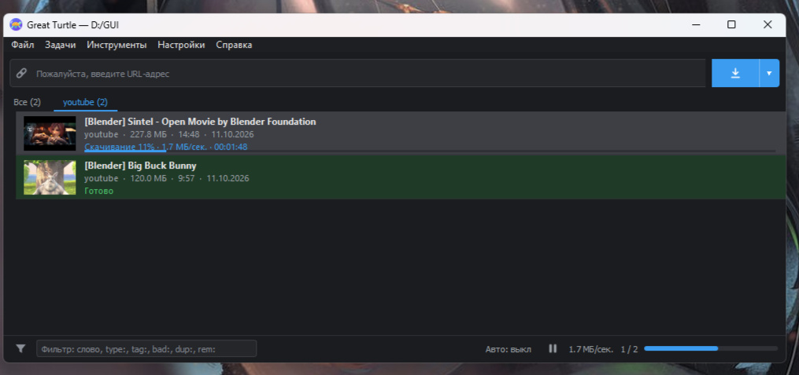

# Great Turtle / Великая черепаха

**RU.** Great Turtle — программа для Windows для скачивания видео, музыки и изображений.
Написана с нуля на PyQt5 поверх [yt-dlp](https://github.com/yt-dlp/yt-dlp) и
[gallery-dl](https://github.com/mikf/gallery-dl); для склейки используется ffmpeg.
Это неофициальная программа: она не связана с Hitomi Downloader, YouTube и другими сайтами и не использует их
названия, значки или код.

**EN.** Great Turtle is a Windows program for downloading videos, music and images. It is written from scratch with
PyQt5 on top of yt-dlp and gallery-dl, and uses ffmpeg for merging. It is an unofficial program: it is not affiliated
with Hitomi Downloader, YouTube or any other site and does not use their names, icons or code.

## Скриншоты / Screenshots

## Установка / Install
1. Распакуйте папку / Unpack the folder.
2. Запустите `install.bat` / Run `install.bat` (Python, libraries, ffmpeg, Deno; needs internet, Windows 10/11).
3. Откройте ярлык на рабочем столе или `app.pyw` / Open the desktop shortcut or `app.pyw`.

Подробнее — «Справка» в самой программе / See the in-app Help.

## Лицензия / License
Программа распространяется по лицензии **GNU GPL v3** (файл `LICENSE`), без каких-либо гарантий.
Причина: PyQt5 распространяется по GPL v3. Исходный код — это сами файлы `.py` и `.pyw` в папке программы.
Free software under **GNU GPL v3** (see `LICENSE`), with no warranty. Reason: PyQt5 is distributed under GPL v3.
The source code is the `.py` / `.pyw` files in the program folder.

## Благодарности / Credits
- [yt-dlp](https://github.com/yt-dlp/yt-dlp) — The Unlicense
- [gallery-dl](https://github.com/mikf/gallery-dl) — GPL v2
- [PyQt5](https://www.riverbankcomputing.com/software/pyqt/) — GPL v3 / commercial
- [FFmpeg](https://ffmpeg.org/) — LGPL/GPL, [Deno](https://deno.com/) — MIT
(ffmpeg and Deno are downloaded by the installer; they are not part of this archive.)

## Ответственность / Responsibility
Используйте программу только для материалов, которые вы вправе скачивать. Вы сами отвечаете за соблюдение
законов вашей страны и правил сайтов. / Use the program only for material you have the right to download.
You are responsible for obeying the law of your country and the terms of the sites.

## Support

Программа бесплатная. Если она пригодилась, поддержать разработку можно добровольно: https://boosty.to/great_turtle/donate
Закрытых функций за это нет.

The program is free. If you find it useful, you can support its development voluntarily: https://boosty.to/great_turtle/donate
No locked features in return.
